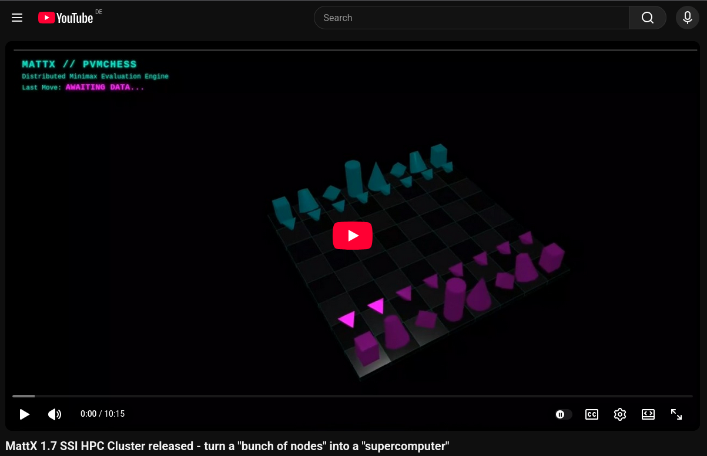

# MattX - The Modern Single System Image (SSI) Cluster

<div align="center">
  
  <p><em>3DMattX: Gamified, real-time 3D cluster visualization and load monitoring.</em></p>
</div>

[](https://www.gnu.org/licenses/old-licenses/gpl-2.0.en.html)
[]()

**MattX** is a modern, out-of-tree Linux kernel module that brings the magic of **Single System Image (SSI)** clustering to the Linux 7.x era. 

Inspired by the legendary openMosix project, MattX allows multiple physical or virtual machines to act as one massive, unified computer. It autonomously load-balances CPU-bound tasks by seamlessly teleporting running processes across the network—preserving their memory, CPU registers, file descriptors, and network sockets—without requiring any modifications to the Linux kernel source code.

---

## 📰 Latest News

*October 2026*

## 🚀 MattX 1.9: The Distributed Shared Memory (DSM) Evolution 🧠🕳️

<div style="display: inline-flex; align-items: center;">
  <a href="https://youtu.be/RscWxkt_DCs" target="_blank" style="display: inline-block;">
  <b>MattX 1.9 MESI DSM demo on Youtube</b> 
  <br>
    
  </a>

</div>

<br>

Welcome to **MattX 1.9**, the release that officially transforms MattX from an advanced process migrator into a true, hardware-accurate **Single System Image (SSI) Hypervisor**. 

With this release, we have successfully bent the Linux Virtual Memory subsystem to our will. MattX now allows complex, multi-process HPC applications and AI training workloads to seamlessly migrate across the cluster while maintaining perfect synchronisation over **Distributed Shared Memory (DSM)**.

### 🌌 The Crown Jewel: Pluggable Cache Coherence (DSM)
Migrating processes that share memory (System V IPC) across a network is notoriously difficult. MattX 1.9 solves this by introducing "Ghost VMAs"—hollow memory mappings on remote nodes rigged with custom kernel tripwires. When a migrated process touches this memory, MattX catches the Page Fault and teleports the physical RAM across the TCP Wormhole.

Because there is no "one size fits all" for distributed memory, MattX 1.9 introduces **four pluggable DSM algorithms**, configurable on-the-fly via `/proc/mattx/admin` or `mattx.conf`:

*   **Mode 0 (Lazy Mode):** Uncoherent, fast local caching. Best for Read-Only datasets.
*   **Mode 1 (The Dirty Sweeper):** Eventual consistency. A background Kthread batches dirty pages and syncs them to the Home Node every 50ms.
*   **Mode 2 (The MESI Protocol) [DEFAULT]:** The Industry Standard. A mathematically perfect, strict cache coherence engine. 
    *   **The Master Directory:** The Home Node (VM1) maintains a Node-Local Global Directory tracking the exact state (`SHARED`, `EXCLUSIVE`, `INVALID`) of every 4KB page.
    *   **The Read-Only Trapdoor:** Remote nodes map pages as strictly Read-Only. Reads execute at native hardware speed with zero network traffic.
    *   **The Write-Acquire Pipeline:** Writes trigger a Write-Protect Fault. The node asks VM1 for an `EXCLUSIVE` lock. VM1 broadcasts `INVALIDATE` requests to all other nodes, shooting down their caches, before granting the lock and allowing the writer to upgrade to Read-Write.
    *   **The PTE Shootdown:** Native processes running on the Home Node are fully integrated into the Matrix. MattX uses `unmap_mapping_range` to shoot down native Page Table Entries, forcing local processes to fault and flush dirty data from remote nodes!
    *   **The Funeral Flush:** When a process exits, MattX proactively fires a 1-Way Data Bomb to sync any dirty `EXCLUSIVE` pages back to the Home Node before destroying the memory.
*   **Mode 3 (The Single-Step Route):** God Mode. MattX puts a leash on the CPU using the hardware Trap Flag (`X86_EFLAGS_TF`), executing exactly one assembly instruction natively before catching the `#DB` exception to sync the data. 

### 🖥️ The True Supercomputer Experience
MattX 1.9 consolidates our massive architectural milestones, turning a bunch of standard networked Linux boxes into a single, unified supercomputer:
*   **Identity Theft (The Silent Ninja):** Syscalls are intercepted and executed natively on the Home Node by Kworkers that temporarily steal the `mm`, `cred`, `nsproxy`, and `files` structs of the original process. Zero split-brain deadlocks.
*   **Global Cluster Filesystem:** **MattXFS** provides a seamless, cluster-wide VFS using Mount Namespaces.
*   **Gang Migration:** Multi-threaded monsters are migrated together. Registers, FPU/AVX states, and TLS are packed into a Blueprint and injected into dummy clones on the target node.
*   **Syscall-Level Load Balancing:** The cluster breathes naturally, balancing CPU load across nodes at the syscall level, completely transparent to the user.

### 🏆 Massive Community Kudos: Kris Buytaert
A hypervisor is only as strong as its QA, and MattX 1.9 owes a massive debt of gratitude to our legendary contributor, **Kris Buytaert**. 

Kris brought the power of **Test-Driven Development (TDD)** to the MattX Lab by building the automated **MattX TestSuite**. Through his relentless testing and bug hunting, Kris uncovered and submitted surgical Pull Requests for incredibly complex edge cases, including:
*   Fixing `kzalloc` dispatch flag corruption in the RPC workers.
*   Solving PhD-level `CLOCK_MONOTONIC` time skew deadlocks for migrated absolute timers.
*   Implementing production-grade timeouts for the `expel` cordon-and-drain loops.

Kris, your automated tests and surgical PRs are what push MattX from an "experiment" to "production-grade." Thank you! 🙌

Please find Kris's **MattX TestSuite** at: 
https://github.com/KrisBuytaert/mattx-testsuite

Kris' latest **MattX 1.9 TestSuite Results**
https://krisbuytaert.be/mattx-test-reports/#q=3f4e121d9bbd

---


## Testing MattX with EESSI

*September 2026*

<div style="display: inline-flex; align-items: center;">
  <a href="https://www.eessi.io/docs/blog/2026/09/08/testing-mattx-with-eessi/" target="_blank" style="display: inline-block;">
    <b>European Environment for Scientific Software Installations (EESSI)</b><br>
    
  </a>

</div>

<br>
A huge shoutout to #openMosix legend <a href="https://mastodon.social/@krisbuytaert">Kris Buytaert</a> for his featured article on the "European Environment for Scientific Software Installations (EESSI)" blog about "Testing MattX with EESSI"

Many Thanks Kris! Awesome 🔥

---


## 🚀 MattX 1.8 now supports thread migration!

<div style="display: inline-flex; align-items: center;">
  <!-- Video Thumbnail -->
  <a href="https://www.youtube.com/watch?v=_uAQgJN24HY" target="_blank" style="display: inline-block;">
    
  </a>

</div>

*August 2026*
The impossible has been achieved. Historically, multi-threaded applications were the ultimate boogeyman of Single System Image (SSI) clustering. Splitting threads across a network meant split-brain deadlocks, shattered memory spaces, and kernel panics. Not anymore. 

With MattX 1.8, we are incredibly proud to introduce **Native Gang Migration**! 🐙

We have completely re-engineered the MattX core to support complex, multi-threaded workloads, bringing us one massive step closer to full MPI/MPICH cluster compatibility.

### 👯‍♂️ The Threading Monsters Tamed
In MattX, threads sharing a `TGID` are considered a "Gang" and are never split up. When the Mother task migrates, the entire Gang teleports through the TCP Wormhole with her. 
* **Native Futex Synchronization:** Because the entire Gang shares the same physical RAM on the remote node, local synchronizers like `futex` and `rseq` execute 100% natively. No network tunneling required!
* **The Gang Grower 🌱 & Ghost Exorcist 👻:** MattX dynamically adapts to thread lifecycles. If threads are born on the remote node, the Home Node natively spawns missing dummy threads during Recall. If threads die remotely, the Home Node silently assassinates the leftovers.
* **The True Freeze 🧊:** Ironclad kernel-level synchronization guarantees threads are perfectly frozen at the user-space boundary before a single byte of memory is carved.

### 🏎️ The HPC Fast-Path (Local Library Optimization)
Why tunnel static, read-only system libraries over the network? MattX 1.8 introduces a configurable bypass that allows the remote node to natively load system libraries (e.g., `/lib/libc.so.6`, `/etc/ld.so.cache`) from its own local disk. This saves massive amounts of Wormhole bandwidth, drops latency to zero, and allows complex C++ stack unwinders to execute flawlessly!

### 🧠 The Dynamic Brain Carver
Our memory injection pipeline has been upgraded with a surgical "Hole Carver". It dynamically detects growing thread stacks and heap expansions, carving out exact memory holes using `MAP_FIXED` without fragmenting the VMA tree or destroying file-backed executable memory.

### 🛠️ Massive Syscall Arsenal for MPI/MPICH Support
To achieve our goal of full MPI/MPICH compatibility, MattX 1.8 introduces a massive array of newly intercepted and routed syscalls, ensuring complex HPC apps feel right at home:
* **Advanced Networking:** `getsockname`, `getpeername`, `setsockopt`, `getsockopt`, `sendmsg`, `recvmsg`
* **Event Loops (epoll):** `epoll_create`, `epoll_create1`, `epoll_ctl`, `epoll_wait`
* **Metadata & VFS:** `statfs`, `fstatfs`, `newfstatat`, `faccessat2`, `readlink`, `readlinkat`, `getdents64`, `pipe2`, `pread64`
* **Process Control:** `uname`, `prlimit64`, `prctl`, `fcntl`, `ioctl`
* **Local Memory & Sched (Native VM2 Execution):** `mprotect`, `madvise`, `mbind`, `sched_getaffinity`, `sched_setaffinity`, `sched_yield`


### 🚀 MattX v1.7 Released: The "Native Injector" & Alma Linux Support!

<div style="display: inline-flex; align-items: center;">
  <!-- Video Thumbnail -->
  <a href="https://www.youtube.com/watch?v=am8meoc2H1s" target="_blank" style="display: inline-block;">
    
  </a>

</div>


---

*June 2026*
MattX v1.7 is our most stable and architecturally advanced release yet! We have completely re-architected the system to cleanly separate the **Control Plane** (process migration, lifecycle) from the **Data Plane** (File and Network I/O). 
* **Kworker + Native Injector:** We have moved away from the legacy "Deputy Hijack" (waking the sleeping home process via signals) for most syscalls. Instead, MattX now spawns background kernel threads (`kworkers`) that execute syscalls natively and forcefully inject the resulting `struct file *` directly into the sleeping Deputy's FD table. All core File and Network I/O syscalls have been refactored to this blazing-fast architecture!
* **Alma Linux & SELinux Victory:** MattX is now fully supported on RPM/RHEL-based distributions like Alma Linux. Even better? Because our Native Injector perfectly mimics standard local process behavior, **MattX runs flawlessly with SELinux set to ENFORCING!**
* **Version Interface:** You can now check your running cluster version via the new read-only `/proc/mattx/version` interface.

### 🛠️ The New MattX-TestSuite by Kris Buytaert
*June 2026*
A massive shoutout to openMosix legend Kris Buytaert for contributing the official **MattX-TestSuite**! This powerful Makefile/Bash toolkit uses `libvirt` and official cloud images to fully automate the deployment of a MattX cluster. With a single `make debcluster` command, you can spin up a fully configured, multi-node MattX development environment in under 5 minutes. It currently supports Debian, Ubuntu, and Alma Linux!
Please find it at: 
https://github.com/KrisBuytaert/mattx-testsuite

👉 **[Read older updates in our NEWS archive](./NEWS.md)**

---

## ✨ Key Features (MattX v1.9)

### 🧠 Live Process Teleportation & The Syscall Drainer
MattX migrates running processes safely using a custom **Syscall Drainer**. Instead of violently freezing processes with `SIGSTOP` while they hold kernel locks, MattX uses modern `task_work_add(TWA_SIGNAL)` to gently guide the process to the user-space boundary. Once in a 100% stable state, its memory map (VMAs), CPU registers (`pt_regs`), and credentials (`struct cred`) are extracted and streamed over a custom TCP data pump to the target node.

### Distributed Shared Memory (DSM)
We have officially conquered the final boss of Single System Image (SSI) clustering: **Distributed Shared Memory (DSM)**. MattX 1.9 features a hardware-accurate, software-defined DSM using the **MESI Cache Coherence Protocol**. What does this mean? It means you can take a complex, multi-process application and MattX will seamlessly migrate the worker processes across your network nodes. 

### 👯‍♂️ Thread Migration
Historically, multi-threaded applications have been the "boogeyman" of Single System Image (SSI) clustering. Because threads share memory, file descriptors, and signal handlers, splitting them across a network introduces catastrophic latency and split-brain deadlocks. MattX solves this natively using a strict **Gang Migration** architecture.

### 🗂️ MattXFS & The Namespace Illusion
To ensure migrated processes can still access their original files, MattX introduces **MattXFS**, a custom Virtual File System (VFS). 
When a process arrives on a remote node, MattX spawns a surrogate (`mattx-stub`) inside a private Linux Mount Namespace (`unshare(CLONE_NEWNS)`). The stub bind-mounts the remote MattXFS cluster tree (e.g., `/mattxfs/709/`) directly over its own root directory (`/`). 
* **The Result:** The Linux VFS natively routes all file operations (`open`, `read`, `write`, `seek`, `fsync`) across the network back to the Home Node. This completely eliminates the need for hacky Kprobes for file I/O!

### ⚡ Direct File System Access (DFSA)
For true High-Performance Computing (HPC), sending file I/O over a TCP wormhole is a bottleneck. MattX supports **DFSA**. If your cluster shares a SAN or NFS drive (e.g., `/mnt/shared`), you can configure MattX to bypass the network. The Namespace Illusion will bind-mount the local SAN directly into the surrogate's glass box, allowing migrated processes to read and write shared data at bare-metal disk speeds.

### 🌐 The Network I/O Wormhole
Migrated processes don't lose their network connections! MattX uses Kretprobes to intercept network system calls (`socket`, `bind`, `listen`, `connect`, `sendto`, `recvfrom`). It tunnels these requests back to the Home Node, allowing a process running on Node B to maintain an active TCP connection established on Node A. It even features a **Distributed Wait Queue** to seamlessly route asynchronous `poll()` and `select()` calls across the cluster!

### 🔄 Perfect Lifecycle Symmetry (The Funeral Director)
MattX maintains strict tracking of exported "Deputies" and remote "Surrogates." If a migrated process finishes its work and exits naturally, the remote node sends a Death Certificate back home to cleanly terminate the Deputy. If a Sysadmin types `kill -9 <pid>` on the Home Node, an Assassination Order is instantly dispatched to terminate the remote Surrogate. No ghost processes, no memory leaks.

---

## ⚙️ Configuration (`/etc/mattx.conf`)

MattX is designed to be "Zero-Config" via UDP Multicast auto-discovery, but it offers powerful toggles for cluster administrators:

```ini
# Network interface and UDP Multicast group for Zero-Config Auto-Discovery
INTERFACE=enp1s0
MULTICAST_GROUP=239.0.0.1
PORT=7225
# AUTODISCOVERY can be 'multicast' (default) or 'sweep' (for cloud VPCs)
AUTODISCOVERY=multicast
# Set to 0 to auto-generate Node ID from MAC address
NODE_ID=0
# configure the behavior of the cluster
MIGRATE_NETWORK_IO=true     # Set to true to enable network I/O migration, false to disable
MIGRATE_FILE_IO=true        # Set to true to enable file I/O migration, false to disable
MATTXFS_ENABLED=true        # Set to true to enable MattXFS, false to disable
DFSA_DIR=/mnt/shared        # Directory for Direct File System Access (DFSA) 
MPI_SUPPORT=false           # Set to true to enable MPI support, false to disable
ACCEPT_GUESTS=true          # Set to true to allow migrating processes to this node, false to disallow
LOCAL_LIBS=true             # Set to true to use local libraries for migrated processes, false to use remote libraries

# Distributed Shared Memory (DSM) Cache Coherence Algorithm
# 0 = Lazy Mode (Uncoherent, fast local caching, good for Read-Only)
# 1 = Dirty Sweeper (Eventual Consistency, syncs every 50ms)
# 2 = MESI Protocol (Hardware-grade strict consistency) [DEFAULT]
# 3 = Emulation Route (Zero caching, strict consistency)
DSM_MODE=2

# configure your default included processes to migrate for the cluster
MATTX_INCLUDE="pvmchess-client,mpichess-client,migtest,migtest2,migtest3,dfsatest,epolltest"

# processes that must never migrate; wins over MATTX_INCLUDE and replaces the built-in list
MATTX_EXCLUDE="cat,watch,cron,top,bash,make,pvmd,sshd,sshd-session,mattx-discd,mattx-stub,systemd,systemd-journald,systemd-journal,puppet,node_exporter"
```

---

## 📊 Administration & Monitoring (`/proc/mattx/`)

MattX embraces the UNIX philosophy. The entire cluster can be monitored and controlled using simple text files in the `/proc/mattx/` virtual directory.

### Read-Only Monitoring
* `cat /proc/mattx/nodes` - Displays a live table of all connected nodes, their IP addresses, CPU load, and Free Memory.
* `cat /proc/mattx/remote` - Lists all processes that have been migrated *away* from this node (`<orig_pid>:<target_node>`).
* `cat /proc/mattx/guests` - Lists all foreign processes currently running *on* this node (`<local_surrogate_pid>:<home_node>`).
* `cat /proc/mattx/version` - Displays the current MattX version and license information.

### Real-Time Cluster Control
You can control the cluster dynamically by echoing commands into `/proc/mattx/admin`:

```bash
# Disable the automatic load balancer (useful for manual testing)
echo "balancer 0" > /proc/mattx/admin

# Manually migrate a specific PID to a specific Node ID
echo "migrate 1234 814" > /proc/mattx/admin

# Recall a migrated process back to its Home Node!
echo "migrate 1234 home" > /proc/mattx/admin
```

---

## 🛠️ The Ecosystem Tools

* **`mattx.ko` & `mattxfs.ko`**: The core kernel modules.
* **`mattx-discd`**: The user-space UDP discovery daemon. It reads `/etc/mattx.conf` and configures the kernel via Generic Netlink.
* **`mattx-stub`**: The user-space surrogate binary. It carves memory, builds the Namespace Illusion, and sacrifices itself to receive the brain transplant of a migrated process.
* **`3DMattX`**: A gamified, WebGL-based 3D cluster visualization tool. Fly through your cluster in real-time and watch the CPU load bars rise and fall as processes migrate!

---

## Requirements and Kernel Support 

**MattX** is developed and tested on Debian Trixie for Kernel 6.x and Ubuntu 26.04 for Kernel 7.x. It is also fully supported on Alma Linux (Kernel 6.x) with SELinux enforcing!

---

## 📜 License

MattX is proudly open-source and released under the **GNU General Public License v2.0 (GPLv2)** to ensure maximum compatibility with the Linux kernel ecosystem. 

**Copyright (c) 2026 by Matthias Rechenburg.**
